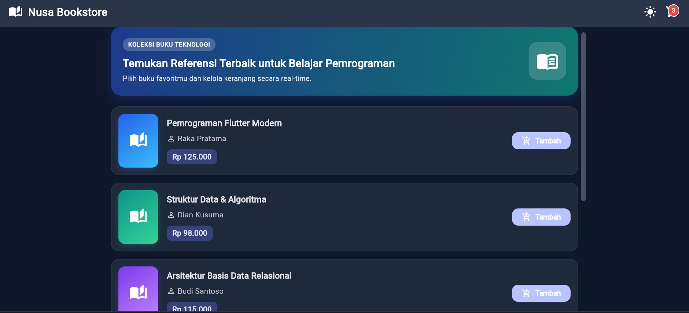
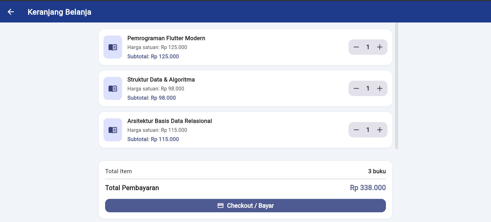
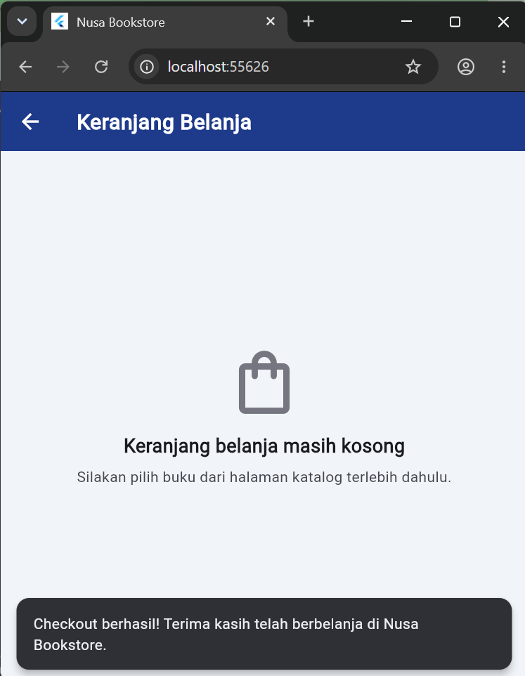

# ppm_sesi4 — Nusa Bookstore

Aplikasi katalog buku sederhana dengan State Management **Provider** (`ChangeNotifier`, `MultiProvider`, `Consumer`, `context.watch`, dan `context.read`), fitur keranjang belanja, checkout, serta dukungan Light Mode dan Dark Mode.

## Getting Started

This project is a starting point for a Flutter application.

A few resources to get you started if this is your first Flutter project:

- [Learn Flutter](https://docs.flutter.dev/get-started/learn-flutter)
- [Write your first Flutter app](https://docs.flutter.dev/get-started/codelab)
- [Flutter learning resources](https://docs.flutter.dev/reference/learning-resources)

For help getting started with Flutter development, view the
[online documentation](https://docs.flutter.dev/), which offers tutorials,
samples, guidance on mobile development, and a full API reference.

### Badge Jumlah Keranjang

### Dark Mode

### Halaman Keranjang & Total Harga

### SnackBar Setelah Checkout
